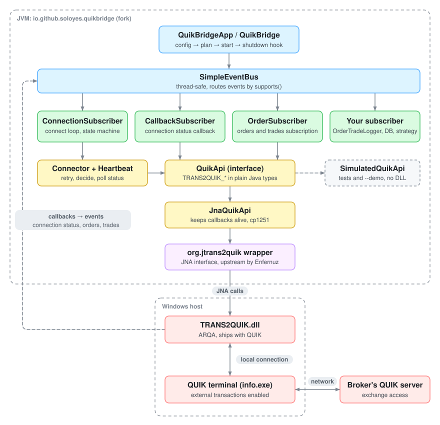
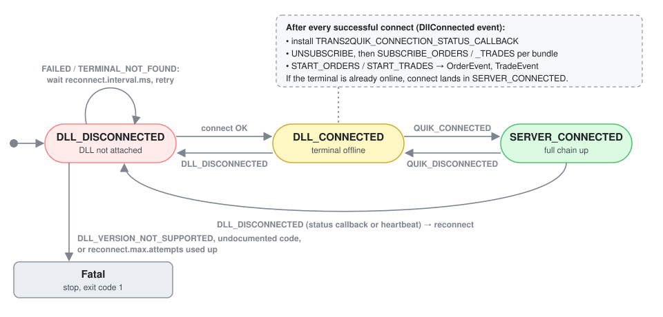
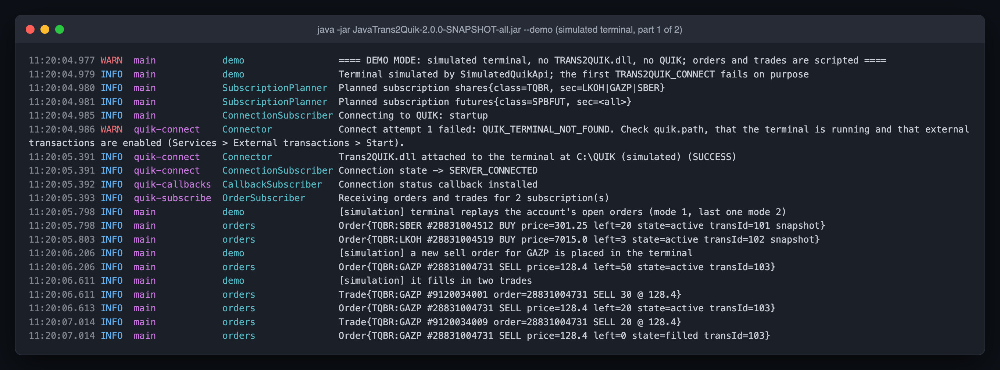
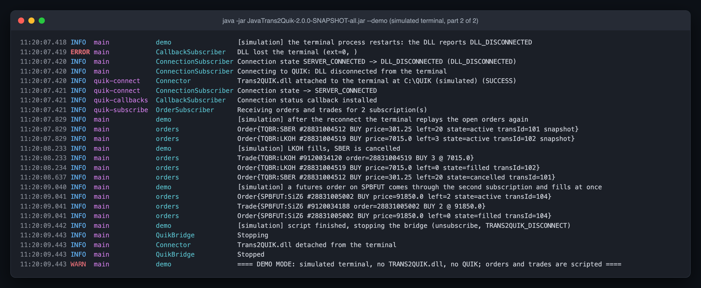
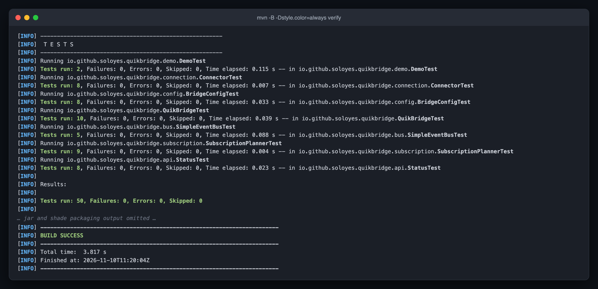

# JavaTrans2Quik / quik-bridge

[](https://github.com/soloyes/JavaTrans2Quik/actions/workflows/ci.yml)

Java access to Trans2Quik.dll, the transaction API of the [QUIK](https://arqatech.com/) trading terminal by ARQA,
plus a small connector service on top of it.

This is a fork. The JNA wrapper (`org.jtrans2quik`) was written by
[Arsentii Nerushev (Enfernuz)](https://github.com/Enfernuz) in
[Enfernuz/JavaTrans2Quik](https://github.com/Enfernuz/JavaTrans2Quik), 2015 to 2019, and the credit for it is his.
The fork adds quik-bridge (`io.github.soloyes.quikbridge`), an application that keeps a connection to the
terminal alive and streams the account's orders and trades.

| | Upstream (Enfernuz) | Added in this fork |
|---|---|---|
| `org.jtrans2quik.wrapper.Trans2QuikLibrary` | JNA mapping of all TRANS2QUIK_* functions and callbacks | typed `TradeStatusCallback` |
| `org.jtrans2quik.loader.Trans2QuikLibraryLoader` | loads the DLL | JNA 5 `Native.load`, windows-1251 strings |
| `io.github.soloyes.quikbridge` | | connector service: config, reconnect loop, heartbeat, event bus, orders and trades subscription, tests, demo mode |

## What quik-bridge does

1. Reads `app.properties`.
2. Calls `TRANS2QUIK_CONNECT` until the terminal answers. Retries on `FAILED` and `QUIK_TERMINAL_NOT_FOUND`,
   stops with exit code 1 on `DLL_VERSION_NOT_SUPPORTED`, on an undocumented code, or when
   `reconnect.max.attempts` runs out.
3. Installs the connection status callback. `DLL_DISCONNECTED` (from the callback, or noticed by the
   heartbeat polling `TRANS2QUIK_IS_DLL_CONNECTED`) starts the reconnect loop again.
4. After each connect it calls `TRANS2QUIK_SUBSCRIBE_ORDERS` / `_TRADES` for every configured bundle, then
   `TRANS2QUIK_START_ORDERS` / `_TRADES`. Each order and trade callback becomes an `OrderEvent` /
   `TradeEvent` on the bus. The default sink logs them; register your own subscriber to do more.
5. On Ctrl+C or service stop: unsubscribe, `TRANS2QUIK_DISCONNECT`, stop threads.

Trans2Quik delivers your own orders and fills plus connection status, and it sends transactions. It has no
order book, quotes or market trades API. For market data use QLua, for example
[quik-lua-rpc](https://github.com/Enfernuz/quik-lua-rpc) by the same upstream author.



### Connection states



`DllConnected` triggers the setup after every successful connect, so a terminal restart gives you a fresh
callback, fresh subscriptions and a replay of the existing orders (mode 1, last one mode 2) before new ones
(mode 0).

## Demo without a terminal

```bash
java -jar JavaTrans2Quik-2.0.0-SNAPSHOT-all.jar --demo
```

This runs the same `QuikBridge` wiring, threads and subscribers as a real start, but against `SimulatedQuikApi`,
the in-memory stand-in for the DLL that the test suite uses. The script is fixed: the first connect attempt
fails, the second succeeds, the open orders are replayed, a GAZP order is placed and filled, the simulated
terminal restarts (`DLL_DISCONNECTED`, reconnect, resubscribe, replay), LKOH fills, SBER is cancelled, a SiZ6
futures order arrives through the second subscription and fills, then the bridge stops. No DLL is loaded and
no terminal, account or exchange is involved; the instruments, numbers and prices are made up. The first and
last log lines say so. `-Dquikbridge.demo.pace.ms=0` removes the pauses between steps.



*Demo mode against the simulated terminal, part 1: the first connect attempt fails, the second attaches the
DLL, the subscriptions go up and the first orders and trades arrive.*



*Demo mode against the simulated terminal, part 2: the terminal drops the DLL, the bridge reconnects and
resubscribes, more fills arrive, then it shuts down.*

## Requirements

- Java 11+ and Maven 3.6+ to build. Builds and tests run on any OS.
- To run against a real terminal: Windows, a running QUIK terminal with external transactions enabled
  (*Services → External transactions → Start*), and `TRANS2QUIK.dll` that matches the terminal version and the
  JVM bitness (64-bit DLL for a 64-bit JVM).

### Where to get TRANS2QUIK.dll

The DLL is ARQA's binary and is not in this repository. It ships in the QUIK terminal folder; the API package and
its documentation are on [ARQA's site](https://arqatech.com/ru/support/files/). Put the DLL on `PATH` or point JNA
at its folder with `-Djna.library.path=C:\QUIK`. A DLL older or newer than the terminal returns
`DLL_VERSION_NOT_SUPPORTED`, so take the one from your own terminal.

## Build and test

```bash
mvn verify            # compile, run the JUnit 5 suite, build jars
```

Tests use `SimulatedQuikApi`, an in-memory stand-in for the DLL. No test touches `JnaQuikApi` or
`Trans2QuikLibraryLoader`, so `TRANS2QUIK.dll` is never loaded and the suite runs on Linux and macOS (and in CI).



*`mvn -B verify` on macOS, colour forced with `-Dstyle.color=always`: 50 tests, no terminal needed.*

Outputs:

- `target/JavaTrans2Quik-<version>.jar`: library jar (wrapper + quik-bridge classes)
- `target/JavaTrans2Quik-<version>-all.jar`: runnable jar with dependencies

## Run

```bat
copy app.properties.example app.properties
rem edit quik.path and the subscriptions
java -Djna.library.path=C:\QUIK -jar JavaTrans2Quik-2.0.0-SNAPSHOT-all.jar
rem or with an explicit config file
java -jar JavaTrans2Quik-2.0.0-SNAPSHOT-all.jar D:\bots\quik.properties
```

Exit codes: `0` normal stop, `1` fatal connection error, `2` configuration error, `3` DLL could not be loaded.
Logs go to the console and `logs/quik-bridge.log` (Logback, see `src/main/resources/logback.xml`).

## Configuration

The config file is found in this order: path given as the first argument, `-Dquikbridge.config=...`,
`./app.properties`, `app.properties` on the classpath. It is read as UTF-8; backslashes are doubled as in any
`.properties` file. A missing required key stops the program with exit code 2 and the key's name.

| Key | Default | Meaning |
|---|---|---|
| `quik.path` | required | Terminal folder (with `info.exe`). Quotes around the value are tolerated. |
| `reconnect.interval.ms` | `1000` | Pause between connect attempts. |
| `reconnect.max.attempts` | `0` | Attempts in a row before giving up with exit code 1. `0` = forever. |
| `heartbeat.interval.ms` | `5000` | How often to poll DLL and server status. `0` = rely on the callback only. |
| `run.duration.ms` | `0` | Stop after this long. `0` = until stopped. |
| `subscribe.orders` | `true` | Receive the account's orders. |
| `subscribe.trades` | `true` | Receive the account's trades (fills). |
| `subscription.all` | `false` | One subscription for all classes. |
| `subscription.all.sec.codes` | empty | With `subscription.all=true`: instrument filter, comma-separated; empty = all. |
| `subscription.names` | empty | Comma-separated bundle names (used when `subscription.all=false`). |
| `subscription.class.code.<name>` | required per bundle | Class code, e.g. `TQBR`, `SPBFUT`. Empty = all classes. |
| `subscription.sec.codes.<name>` | empty | Instruments of the bundle, comma-separated; empty = whole class. |

Bundles with the same class code are merged into one subscribe call (the DLL subscribes per class). Example:

```properties
quik.path=C:\\QUIK
subscription.names=shares,futures
subscription.class.code.shares=TQBR
subscription.sec.codes.shares=LKOH,GAZP,SBER
subscription.class.code.futures=SPBFUT
```

Full example: [`app.properties.example`](app.properties.example).

## Using it from code

```java
BridgeConfig config = BridgeConfig.load("app.properties");
List<Subscription> plan = new SubscriptionPlanner(config).plan();

QuikBridge bridge = new QuikBridge(config, plan, new JnaQuikApi(), new SimpleEventBus(),
        QuikBridge::namedSingleThread, Sleeper.SYSTEM)
    .with(new Subscriber() {
        public Set<Class<? extends Event<?>>> supports() { return Set.of(OrderEvent.class, TradeEvent.class); }
        public void handle(Event<?> e) { /* runs on the DLL callback thread: hand off, return fast */ }
    });

Runtime.getRuntime().addShutdownHook(new Thread(bridge::stop));
bridge.start();
```

Swap `JnaQuikApi` for your own `QuikApi` implementation to test strategies without a terminal.

## Project layout

```
src/main/java/org/jtrans2quik/            upstream JNA wrapper (Enfernuz)
src/main/java/io/github/soloyes/quikbridge/
  api/            QuikApi, Status, CallResult, OrderUpdate, TradeUpdate, CStrings
  jna/            JnaQuikApi: QuikApi over the wrapper
  bus/            Event, Subscriber, EventBus, SimpleEventBus
  events/         ConnectRequested, DllConnected, ConnectionStatusChanged, OrderEvent, TradeEvent
  connection/     Connector, ConnectionState, Heartbeat, Sleeper
  subscribers/    ConnectionSubscriber, CallbackSubscriber, OrderSubscriber, OrderTradeLogger
  subscription/   Subscription, SubscriptionPlanner
  config/         BridgeConfig
  demo/           SimulatedQuikApi (stand-in for the DLL), Demo (the --demo script)
  QuikBridge, QuikBridgeApp
src/test/java/    JUnit 5 suite on SimulatedQuikApi
docs/             diagrams, screenshots, Russian guide to the raw wrapper
```

## Low-level wrapper usage

The upstream Russian guide to calling Trans2Quik.dll directly through the wrapper (connect, send a
transaction, callbacks, return codes) is kept in [docs/WRAPPER_RU.md](docs/WRAPPER_RU.md).

## Кратко по-русски

Форк [Enfernuz/JavaTrans2Quik](https://github.com/Enfernuz/JavaTrans2Quik): JNA-обёртка над Trans2Quik.dll
(API транзакций терминала QUIK от ARQA). Обёртку написал Арсентий Нерушев, она осталась почти без изменений.
В форке добавлен сервис quik-bridge:

- подключается к терминалу и переподключается при обрыве (коллбэк статуса плюс периодическая проверка);
- подписывается на заявки и сделки своего счёта по списку классов и бумаг из `app.properties`
  и публикует их как события `OrderEvent` / `TradeEvent`;
- корректно завершает работу: отписка, `TRANS2QUIK_DISCONNECT`, остановка потоков;
- покрыт тестами на подставной реализации DLL (`SimulatedQuikApi`), поэтому собирается и тестируется на любой ОС;
- `java -jar JavaTrans2Quik-2.0.0-SNAPSHOT-all.jar --demo` прогоняет сервис против той же имитации терминала:
  без DLL и без QUIK, заявки и сделки в выводе придуманные.

Стакана и котировок в Trans2Quik нет: это API для транзакций, своих заявок и сделок. Рыночные данные
берите через QLua, например [quik-lua-rpc](https://github.com/Enfernuz/quik-lua-rpc).

`TRANS2QUIK.dll` и руководство QUIK в репозитории не лежат: это файлы ARQA. DLL есть в папке терминала,
документация на [сайте ARQA](https://arqatech.com/ru/support/files/). Как вызывать обёртку напрямую:
[docs/WRAPPER_RU.md](docs/WRAPPER_RU.md).

## Credits and licence

- JNA wrapper: Arsentii Nerushev ([Enfernuz](https://github.com/Enfernuz)), original repository
  [Enfernuz/JavaTrans2Quik](https://github.com/Enfernuz/JavaTrans2Quik), Maven coordinates
  `com.github.enfernuz:JavaTrans2Quik:1.0.1`.
- quik-bridge: Vitalii Solovev ([soloyes](https://github.com/soloyes)).
- QUIK, Trans2Quik.dll and their documentation belong to ARQA Technologies.

The upstream repository has no licence file, and this fork does not invent one for the upstream code: its
author has not stated reuse terms, so ask him before reusing the wrapper beyond what GitHub's terms allow.
The fork has no licence file of its own yet either.
